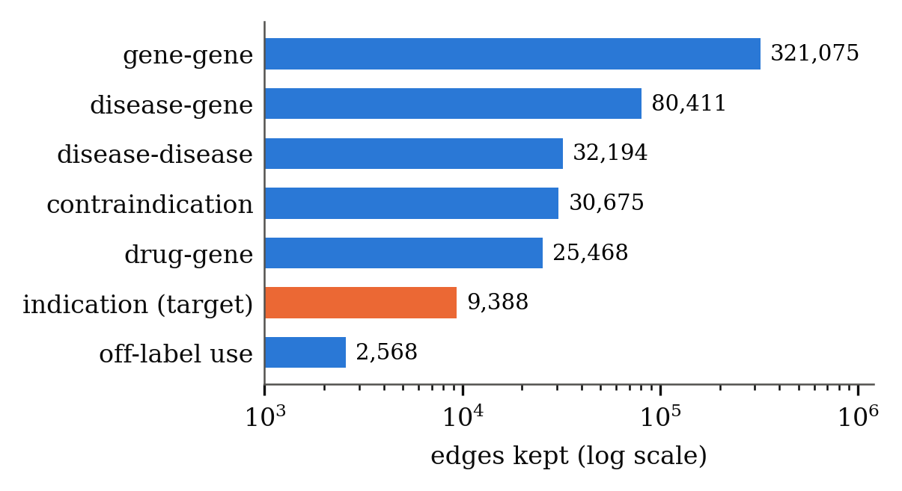
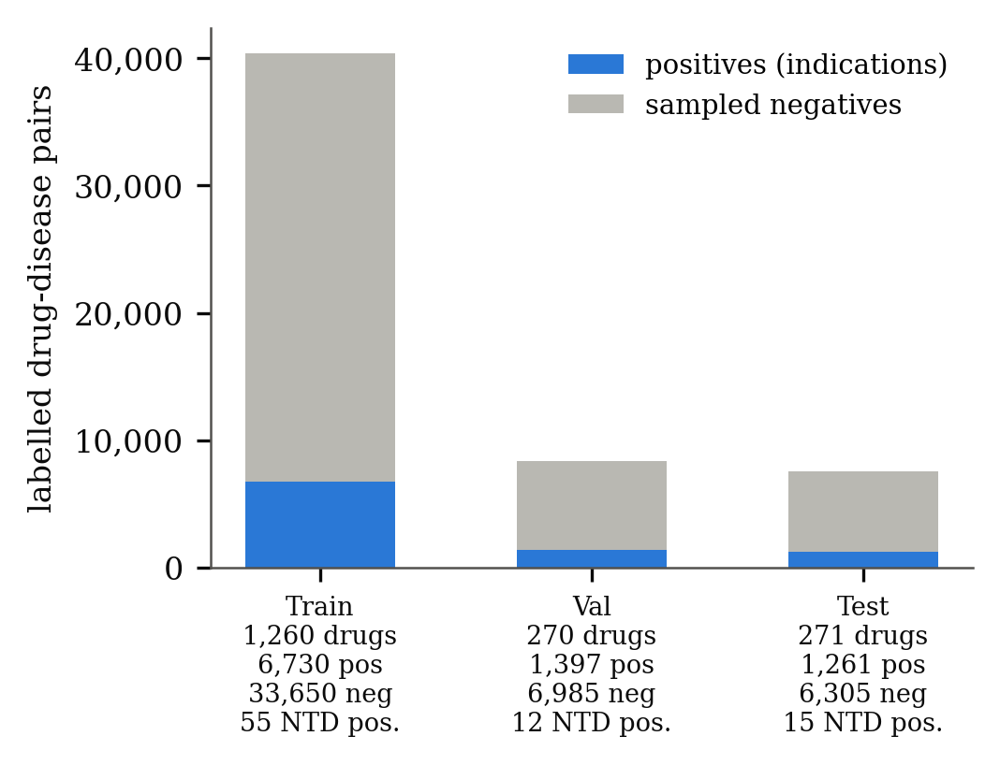
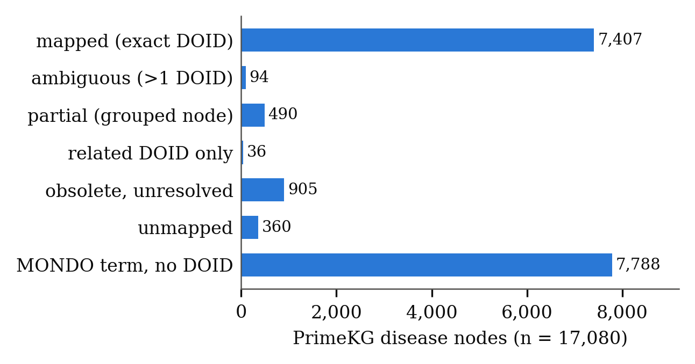
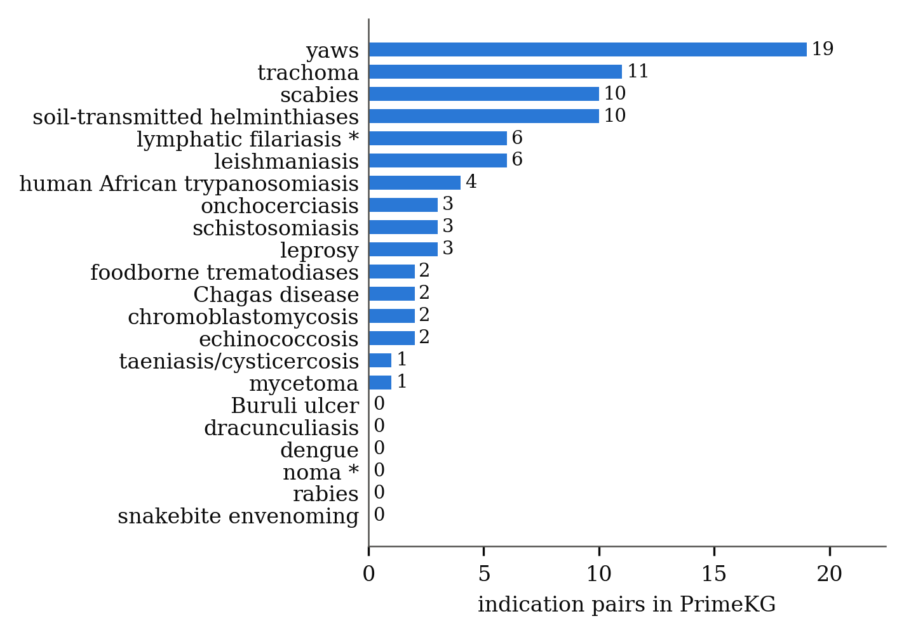
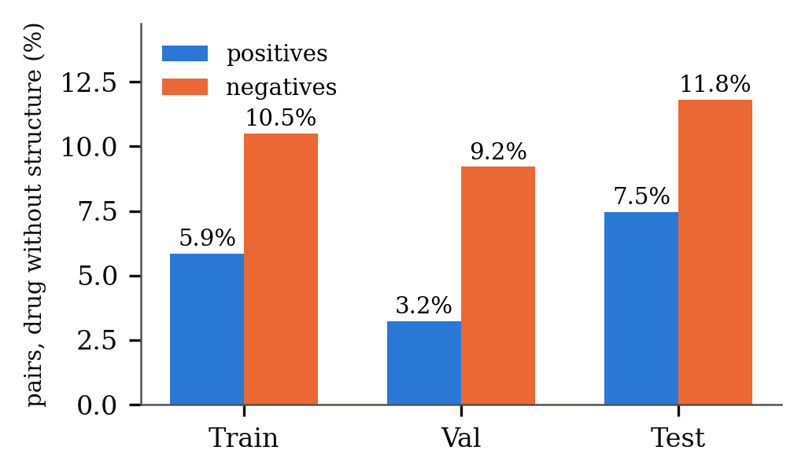
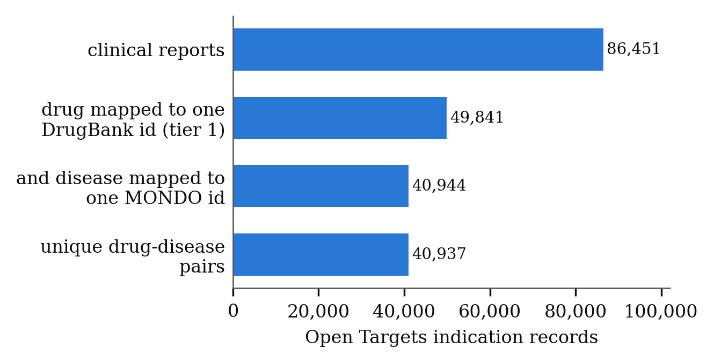
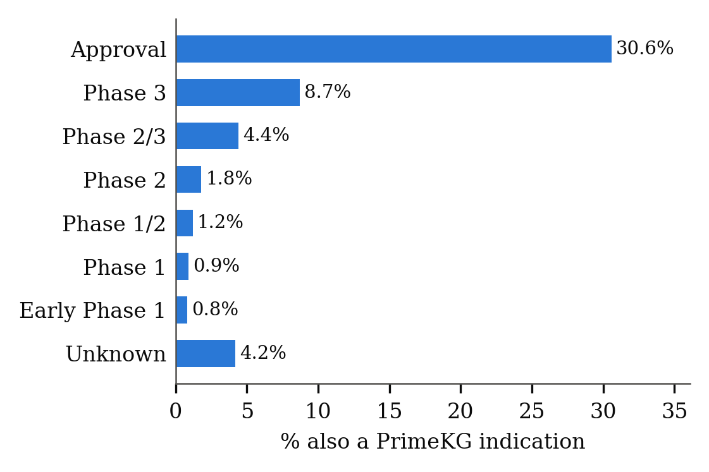
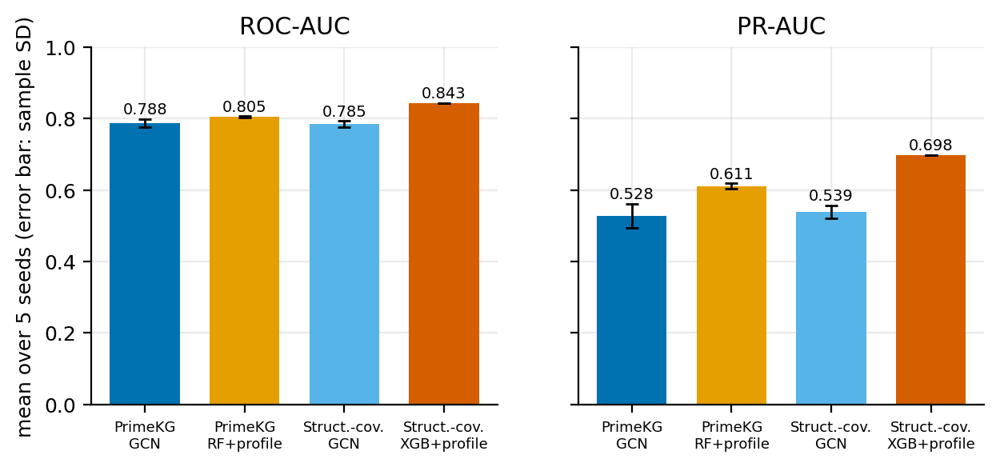
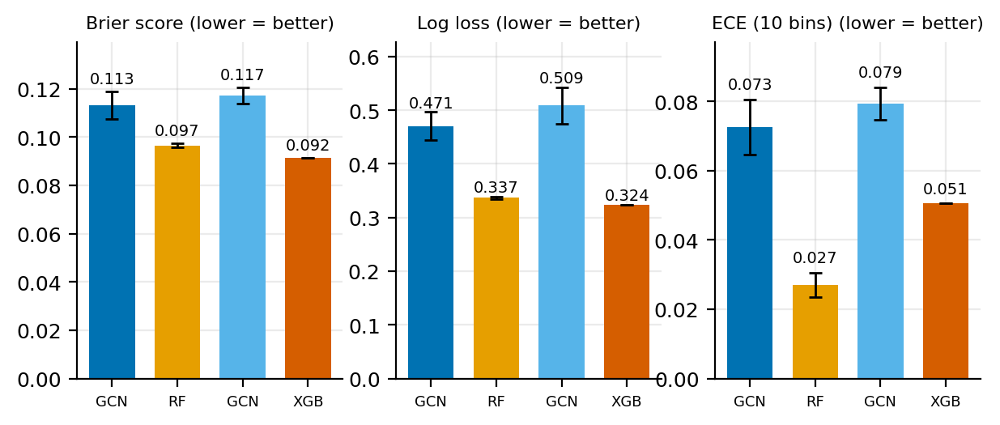
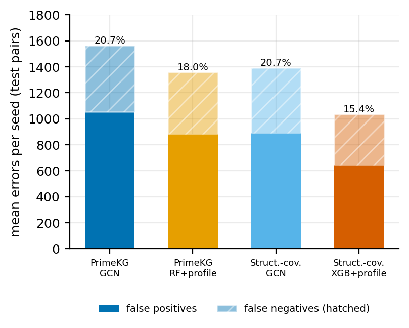

# VectorDrugMatch: Leakage-Controlled, Drug-Disjoint Drug Repurposing on PrimeKG with Neglected-Tropical-Disease Evaluation

**Status:** full draft with results. Data and audit numbers come from `Docs/paper/metrics.json`; model results come from the committed aggregate files in `reports/research_validation_20261111/` (figures 8-11 are drawn from them by `scripts/make_results_figures.py`). Items marked **[PENDING]** are not available in the repository and have not been invented. Bibliography checked against Crossref/arXiv (`CITATION_AUDIT.md`). Current project status and caveats: `Docs/PROJECT_STATUS.md`.

## Abstract
We build a drug-repurposing benchmark on PrimeKG [1] in which a model predicts drug→disease *indications* for drugs never seen in training (drug-disjoint split, seed 42). Contraindications and off-label uses stay as separate graph relations and are never negative labels. The benchmark has 9,388 indication pairs over 7,957 drugs and 17,080 diseases, with a saved split, automatic leakage checks and a disease-mapping audit (MONDO→DOID). Neglected-tropical-disease (NTD) coverage is small (15 test positives), so NTD results are exploratory. We evaluate four model variants over five training seeds on this one fixed split: a GCN on the full benchmark, a Random Forest with a training-side disease-profile feature block, a GCN on the structure-covered subset and an XGBoost model with the same block. Mean ROC-AUC is 0.788, 0.805, 0.785 and 0.843, and mean PR-AUC 0.529, 0.611, 0.539 and 0.698, respectively; calibration, ranking and error analyses and paired bootstrap intervals are reported. Negatives are sampled, all seeds share one split, the variants use different inputs and test sets, and no clinical validation is claimed.

**Index Terms** — drug repurposing, knowledge graph, link prediction, cold-start, neglected tropical diseases, data leakage.

## I. Introduction
Drug repurposing for NTDs is limited by sparse labels. We prioritise an auditable evaluation over model novelty: a fixed drug-disjoint split, explicit label semantics, documented identifier mappings and reported coverage gaps. Contributions: (1) a leakage-checked PrimeKG benchmark; (2) a MONDO→DOID mapping audit and corrected WHO NTD term list; (3) a structure-coverage sensitivity analysis; (4) an audit-first Open Targets loader kept separate from the benchmark; (5) a five-seed cold-start evaluation of four model variants with bootstrap intervals, calibration, ranking and error analyses, reported with the conditions under which each number holds.

## II. Data and Provenance
Table I lists every external source, its role and its licence status. Hetionet [2] is kept as a separate Track-A reference graph and is not part of the results reported here.

**TABLE I.** Data sources and provenance.

| Source | Role | Version / hash | Licence note |
|---|---|---|---|
| PrimeKG `kg.csv` [1] | graph + indication labels | SHA-256 `0a5a010f…c5cb5c69`; Harvard Dataverse doi:10.7910/DVN/IXA7BM | CC0 per Dataverse metadata |
| MONDO `mondo.obo` [3] | disease ID mapping | releases/2026-11-03 (newer than PrimeKG's build) | check upstream |
| Open Targets [4], [5] (3 parquet files) | external clinical evidence (not used for training) | SHA-1 in `Docs/HAI_DOWNLOAD_MANIFEST.md` | Platform marked CC0 1.0 [5]; all five upstream providers contribute to our records (AACT/ClinicalTrials.gov, ChEMBL, TTD, EMA, PMDA); only ChEMBL (CC BY-SA 3.0) is in the platform's licence table; EMA and PMDA website notices permit reuse with acknowledgement; AACT/ClinicalTrials.gov and TTD terms unverified (`Docs/LICENCE_AUDIT.md`) |
| HAI price surveys (Karnataka 2004-11, Maharashtra 2005-01, Delhi 2011-07) | regional access pilot only | manifest | verify |
| IHME GBD 2023 | DALY burden (rate, Global, Both, All ages, 2023) | 17 exported causes -> 15 of 22 project NTD groups; 7 groups missing; unit not verified against IHME documentation | IHME terms (no third-party hosting) |

Fig. 1 shows the PrimeKG relations kept — gene–gene 321,075; disease–gene 80,411; disease–disease 32,194; contraindication 30,675; drug–gene 25,468; **indication 9,388** (the prediction target, highlighted); off-label 2,568.

**Fig. 1.** PrimeKG relations kept in the benchmark graph (log scale). Indication (orange) is the prediction target; contraindication and off-label stay as separate graph relations and are never negative labels.

## III. Labels, Split and Leakage Control
Target: drug→disease indication. Split: drugs partitioned 70/15/15 (1,260 / 270 / 271 drugs), stratified on NTD; negatives sampled 5:1 from pairs that are not indication, contraindication or off-label. Saved once (`splits/seed42.npz`) and read by every model.

**TABLE II.** Drug-disjoint split (seed 42; Table II is also shown in Fig. 2).

| Split | Drugs | Positives | Negatives | NTD positives |
|---|---|---|---|---|
| Train | 1,260 | 6,730 | 33,650 | 55 |
| Val | 270 | 1,397 | 6,985 | 12 |
| Test | 271 | 1,261 | 6,305 | 15 |

**Fig. 2.** Composition of the saved drug-disjoint split. Train, validation and test share no drug. Counts per split are given under each bar; NTD pos. = positive pairs on neglected-tropical-disease terms.

Message-passing graph: all `treats` edges and reverses removed; contraindication/off-label edges on held-out indication pairs dropped. `validate_primekg_dataset.py` reports *all hard checks passed*: no pair or drug shared across splits, every indication in exactly one split, split reproducible, no held-out pair reachable through any drug–disease relation, identical pairs/features for baselines, Node2Vec and GNNs. Known caveat: PrimeKG lists 87 pairs as both indication and contraindication (reported, not hidden).

## IV. Disease Mapping Audit
MONDO [3] terms carry cross-references to DOID; we use only equivalence-qualified (exact) ones. Of 17,080 disease nodes: 7,407 mapped (exact DOID), 94 ambiguous, 490 partial (grouped nodes), 9,089 unmapped (Fig. 3). Indication pairs: 6,262 on fully mapped nodes, 95 ambiguous, 1,019 partial, 2,012 unmapped; nothing is dropped. MONDO obsolescence: 430 IDs replaced, 1,056 obsolete without replacement. The bundled WHO NTD DOID list was wrong for most groups and was rebuilt from curated MONDO terms with run-time name checks. NTD coverage (Fig. 4): 16 of 22 groups have ≥1 indication, 82 unique pairs; groups with zero indications are Buruli ulcer, dracunculiasis, dengue, noma, rabies and snakebite envenoming (asterisk: lymphatic filariasis is an upper bound because MONDO has only a generic filariasis term; noma has no MONDO term).

**Fig. 3.** Mapping status of the 17,080 PrimeKG disease nodes from MONDO to DOID (exact xrefs only). No node is dropped; every one carries a status.

**Fig. 4.** PrimeKG indication pairs per WHO NTD group, from curated MONDO root terms plus descendants (name-checked at run time). * = upper bound / no MONDO term. Counts are small, so NTD results are exploratory.

## V. Chemical-Structure Coverage
996 of 7,957 drugs have no SMILES; 997 have an all-zero fingerprint; 1,615 of 1,801 indication drugs have structures. Missing structure is more common among negatives than positives (Fig. 5; test split 7.5% vs 11.8%), a possible shortcut. Mitigation: `evaluate_primekg.py` reports `with_structure` / `no_structure` subsets alongside `all`; the primary result is `all`. A structure-covered variant (same drug partition and inherited negatives, 6,727 of 7,566 test pairs, NTD positives unchanged at 55/12/15) is built and passes its checks; training on it is **[PENDING]**.

**Fig. 5.** Share of pairs whose drug has no usable chemical structure, by split and label. Negatives lack structure more often than positives in every split, a potential shortcut; evaluation therefore reports with_structure and no_structure subsets.

## VI. Open Targets Loader (external evidence, separate from the benchmark)
86,451 clinical reports (11,378 ChEMBL drugs, 3,631 diseases) from the Open Targets Platform [4]; the platform's clinical-report stage categories are described in its online documentation [5], which is the source for the stage vocabulary used here (the 2023 platform paper [4] predates this dataset and does not describe it). ChEMBL→DrugBank only via explicit cross-references (tier 1: 5,494 drugs); a parent-molecule fallback is a separate tier-2 file. Diseases: MONDO IDs used directly, EFO/Orphanet/NCIT only via exact MONDO xrefs; phenotype/GO terms are not mapped. Result: 40,944 usable rows → **40,937 unique tier-1 pairs**, 4,937 with an APPROVAL report (Fig. 6). `validate_open_targets.py`: all hard checks pass. Stage ordering is **our convention**, not published by Open Targets (the official documentation [5] states one explicit max-stage rule, Phase IV or Withdrawal to Approval, and lists the categories in an order that agrees with ours for every stage present, but prints no numeric ranking); `stages_seen` and an `approved` flag avoid depending on it. Overlap with PrimeKG (Fig. 7), by Open Targets maximum stage (stage ordering is a project convention): about 17% of PrimeKG indications with a mappable drug appear in Open Targets; 31% of approved Open Targets pairs for PrimeKG drugs are PrimeKG indications. Our three Open Targets files are byte-identical (SHA-256) to release 26.09, which allowed every report to be attributed to its provider (`Docs/DATA_PROVENANCE.md`): of 321,785 report references, 267,087 are ClinicalTrials.gov/AACT, 39,089 ChEMBL, 10,383 TTD, 3,581 EMA and 1,645 PMDA; 67,085 of the 86,451 pairs rest on AACT alone, and 47,044 pairs have every supporting report flagged UNVALIDATED_INDICATION (a flag whose semantics the documentation does not settle), so corroboration analyses must filter on it. Shared upstream sources are likely, so this is **not** independent validation.

**Fig. 6.** Open Targets mapping funnel: 86,451 clinical reports reduce to 40,937 unique tier-1 drug-disease pairs (exact DrugBank cross-reference and a single MONDO id).

**Fig. 7.** Share of Open Targets pairs (for drugs also in PrimeKG) that are also PrimeKG indications, by maximum clinical stage; stages with fewer than 50 such pairs are omitted. Not independent validation: upstream sources may be shared.

## VII. Experimental Protocol
Classical models, two variants: Logistic Regression, Naive Bayes, Random Forest [6], XGBoost [7] and an MLP on a 2,048-bit Morgan (extended-connectivity) fingerprint [8] plus either (a) the 3 original disease features (drug-only in effect: one informative flag, `is_ntd`) or (b) the same plus a four-column disease-profile block (below). Graph models: a leakage-safe Node2Vec [9] with a logistic-regression head, and GCN [10], GraphSAGE [11], GAT [12], RGCN [13] and HGT [14] on the message-passing graph. Threshold from validation (Youden); test scored once. Metrics: ROC-AUC, PR-AUC, MCC, Precision@K, Recall@K, MRR, NDCG@K (per disease), plus `ntd_only`, `mapped_only`, `with_structure`, `no_structure`. A cold-start feature-group ablation (full, drug-only, disease-only, zero drug features, and a shuffled-label control that must give ROC-AUC near 0.5), SHAP [15] explanations for the tree models and a local relation-family perturbation analysis for the GNNs are implemented; their outputs are not part of the committed results and are marked **[PENDING]** in Section VIII. The code commit is recorded in the release manifest (`Docs/release/`) and pinned in `notebooks/colab_final_run.ipynb`.

*Disease-profile baseline variant.* Because variant (a) cannot represent drug-disease specificity, a second configuration (`*_dp.yaml`) appends four features per pair, computed only from the training indications of the frozen split: the log of the number of *other* training drugs known to treat the disease, the maximum and mean Tanimoto similarity (Morgan bits) between the candidate drug and those drugs, and an indicator that the profile is non-empty (distinguishing "no evidence" from "dissimilar"). Training positives are scored leave-one-out, so a pair's own label never enters its own feature; validation and test drugs are absent from the training edges by construction (drug-disjoint split), and the function receives no validation/test edges, no held-out pairs and no graph relation (reverse or alternative), which is enforced by unit tests (`tests/test_disease_profile.py`) including identity of the pairs, labels and negatives and of the original feature columns across the two variants. Both variants use the identical saved split and negative samples and the same hyperparameters; they are trained and reported separately and never pooled. Rationale and limits: the block is a nearest-neighbour style signal that lets classical models condition on the disease, giving a fairer comparison with the graph models; it also encodes a popularity signal (diseases with many known drugs), which is a property of the training distribution, and it is evaluated only on held-out drugs. Its measured effect is reported in Section VIII together with the confound it introduces.

*Training and implementation.* All training ran on a Google Colab Tesla T4 (PyTorch 2.14.1, PyTorch Geometric 2.8.1, pyg-lib 0.9.0) from the pinned repository commit `1c85d98a356d62d232aa8f8e3acf5ac497c2532a`; nothing was trained on the authors' workstation. Each GNN uses 64-dimensional node embeddings, two message-passing layers on the heterogeneous message-passing graph and a link head with layers 128, 32 and 1 on the concatenated drug and disease embeddings. Training uses Adam (learning rate 0.005, weight decay 1e-4), gradient-norm clipping at 1.0, a plateau scheduler on validation ROC-AUC, early stopping with patience 20 and at most 100 epochs, binary cross-entropy computed on logits in FP32 under mixed precision, and the checkpoint with the best validation ROC-AUC. During the run the GCN was replaced by a numerically stabilised version (log-scaled degree features and mean aggregation), because the first version produced extreme logits and could not reproduce its saved predictions; **all reported GCN results come from the stabilised model** (`Docs/PROJECT_STATUS.md`, Section 3). The Random Forest uses 100 trees with maximum depth 10 and XGBoost 100 trees with learning rate 0.1; probabilities are sigmoid-calibrated on training data only. Across the five seeds (21, 42, 52, 72, 100) the data, split and negatives are identical, so the reported standard deviations measure training-seed variation on this split, not variation across resampled splits.

*Evaluation statistics.* ROC-AUC and PR-AUC are reported with the average-precision form of the latter, which is the more informative summary when positives are a minority of pairs [16]. Calibration is summarised by the Brier score [17] and the expected calibration error (ECE, ten equal-width bins) as used in [18]. Confidence intervals are percentile bootstrap intervals [19] over the fixed test pairs (3,000 resamples per model; 5,000 for paired differences); they quantify resampling uncertainty of this test set only. Ranking metrics (Precision@K, Recall@K, NDCG@K, average precision) are computed over the sampled candidate pairs of the test split and therefore describe that sample, not a prospective search over all drug-disease pairs.

## VIII. Results
Four variants were evaluated: the PrimeKG GCN, the PrimeKG Random Forest with the disease-profile block (RF+profile), the GCN on the structure-covered subset and the XGBoost model with the profile block on that subset. The full test set has 7,566 pairs (1,261 positives, 6,305 sampled negatives); the structure-covered subset has 6,727 pairs (1,167 positives) because 839 pairs have a drug without a usable structure. **[PENDING]** The remaining trained models (Logistic Regression, Naive Bayes, MLP, Node2Vec, GraphSAGE, GAT, RGCN, HGT and the other classical variants) exist in the authors' private storage but their result files are not in the repository; the table of all models and the criterion by which one model per variant was selected are to be added by the authors. The four rows below must therefore not be read as a ranking of all methods.

**TABLE III.** Five-seed classification performance (mean ± sample SD; seeds 21, 42, 52, 72, 100; one fixed split). Source: `reports/research_validation_20261111/five_seed_performance.csv`.

| Variant | ROC-AUC | PR-AUC |
|---|---:|---:|
| PrimeKG, GCN | 0.7880 ± 0.0118 | 0.5285 ± 0.0334 |
| PrimeKG, RF + disease profile | 0.8049 ± 0.0020 | 0.6113 ± 0.0078 |
| Structure-covered, GCN | 0.7847 ± 0.0089 | 0.5390 ± 0.0182 |
| Structure-covered, XGBoost + disease profile | 0.8433 ± 0.0000 | 0.6979 ± 0.0000 |

**Fig. 8.** Five-seed ROC-AUC and PR-AUC (mean; error bars are the sample SD). The XGBoost bars have zero spread because its predictions were identical across the five seeds, which is not evidence of robustness.

Table III and Fig. 8 show higher mean ROC-AUC and PR-AUC for the tree models with the disease-profile block than for the GCNs on the same split. The seed-42 models give ROC-AUC 0.7787, 0.8043, 0.7838 and 0.8433 and PR-AUC 0.4919, 0.6041, 0.5183 and 0.6979. Percentile bootstrap intervals for these seed-42 models (**TABLE IV**) and paired differences on the same test pairs are below.

**TABLE IV.** Bootstrap uncertainty on the fixed test pairs (seed-42 models; 95% percentile intervals).

| Model | ROC-AUC [95% CI] | PR-AUC [95% CI] |
|---|---|---|
| PrimeKG GCN | 0.77866 [0.76482, 0.79276] | 0.49187 [0.46326, 0.52148] |
| PrimeKG RF + profile | 0.80427 [0.78890, 0.81908] | 0.60413 [0.57581, 0.63139] |
| Structure GCN | 0.78380 [0.76895, 0.79788] | 0.51830 [0.48731, 0.54722] |
| Structure XGBoost + profile | 0.84326 [0.82887, 0.85716] | 0.69788 [0.67244, 0.72279] |
| Paired: RF minus GCN (PrimeKG) | +0.02562 [0.01082, 0.04124] | +0.11227 [0.08582, 0.13765] |
| Paired: XGBoost minus GCN (structure) | +0.05945 [0.04477, 0.07459] | +0.17957 [0.15357, 0.20345] |

The paired intervals exclude zero. They show that, on this test set, the tree models with the profile block ranked held-out pairs better than the GCNs. They do **not** show that tree models outperform graph models in general: the two families receive different inputs (the profile block adds a training-side signal that can act as a disease-popularity feature, Section VII), the structure-covered rows use a different test subset and cannot be compared with the PrimeKG rows, and one split and sampled negatives were used.

**TABLE V.** Ranking metrics over the sampled test candidates (five-seed means). Source: `five_seed_ranking.csv`.

| Variant | Average precision | Precision@10 | Precision@500 | Recall@500 | NDCG@500 |
|---|---:|---:|---:|---:|---:|
| PrimeKG, GCN | 0.5285 | 0.94 | 0.7236 | 0.2869 | 0.7518 |
| PrimeKG, RF + profile | 0.6113 | 0.98 | 0.8172 | 0.3240 | 0.8396 |
| Structure-covered, GCN | 0.5390 | 0.96 | 0.7324 | 0.3138 | 0.7595 |
| Structure-covered, XGBoost + profile | 0.6979 | 1.00 | 0.9060 | 0.3882 | 0.9184 |

**Fig. 9.** Ranking metrics over the sampled test candidates (five-seed means). Panels: average precision, Precision@10, Precision@500, Recall@500, NDCG@500; within each panel the bars are PrimeKG GCN, PrimeKG RF with profile, structure-covered GCN and structure-covered XGBoost with profile.

Table V and Fig. 9 show that precision at the top of the list is high for every variant (0.94 to 1.00 at K = 10), which reflects the composition of the sampled candidate set rather than prospective performance; these metrics should not be read as the yield of a real screening campaign.

**TABLE VI.** Calibration (five-seed mean ± sample SD; lower is better). Source: `five_seed_calibration.csv`.

| Variant | Brier score | Log loss | ECE (10 bins) |
|---|---:|---:|---:|
| PrimeKG, GCN | 0.11320 ± 0.00574 | 0.47067 ± 0.02674 | 0.07255 ± 0.00801 |
| PrimeKG, RF + profile | 0.09658 ± 0.00078 | 0.33695 ± 0.00209 | 0.02705 ± 0.00347 |
| Structure-covered, GCN | 0.11727 ± 0.00349 | 0.50864 ± 0.03458 | 0.07944 ± 0.00469 |
| Structure-covered, XGBoost + profile | 0.09155 ± 0.00000 | 0.32414 ± 0.00000 | 0.05056 ± 0.00000 |

**Fig. 10.** Calibration of the four variants (five-seed mean; error bars are the sample SD; lower is better in every panel).

Among the PrimeKG variants the Random Forest had the lowest ECE; among the structure-covered variants XGBoost had the lowest Brier score and log loss (Table VI, Fig. 10). These values describe probabilities on the sampled test distribution, in which positives make up 16.7% of pairs, and are not calibrated clinical probabilities.

**TABLE VII.** Errors at each model's decision threshold (five-seed means). Source: `five_seed_error_analysis.csv`. The thresholding rule is stored with the per-seed files in private storage and is not documented in the repository.

| Variant | False positives | False negatives | Total errors | Error rate |
|---|---:|---:|---:|---:|
| PrimeKG, GCN | 1052.2 | 512.6 | 1564.8 | 20.68% |
| PrimeKG, RF + profile | 880.6 | 478.4 | 1359.0 | 17.96% |
| Structure-covered, GCN | 890.2 | 502.6 | 1392.8 | 20.70% |
| Structure-covered, XGBoost + profile | 644.0 | 389.0 | 1033.0 | 15.36% |

**Fig. 11.** Mean false positives and false negatives per seed at each model's decision threshold; the label above each bar is the error rate.

Table VII and Fig. 11 count errors at the decision threshold. Because negatives are sampled, an apparent false positive may be a true but unrecorded indication, and a high-confidence false negative is a model error, not necessarily a biological one.

*Neglected tropical diseases.* The NTD-only subset has 140 pairs with 15 positives in the full benchmark and 122 pairs with 15 positives in the structure-covered benchmark. NTD-specific metrics rest on 15 positives and are exploratory; no NTD-specific conclusion is drawn.

*Inference reproducibility.* A packaged GCN inference implementation reproduced the saved test predictions of the PrimeKG GCN on all 7,566 held-out rows: identical entity order, all probabilities finite, maximum absolute probability difference 6.6e-07, mean 2.8e-08 and 100% prediction agreement. This establishes computational reproducibility of that saved benchmark, not predictive validity. The inference package is held in private storage and is not part of the repository.

*Evidence from Open Targets.* A conservative Open Targets evidence cohort had 16,410 candidate pairs, of which 9,065 had both entities covered by the inference inputs and were scored. The pair-level Spearman correlation between clinical stage and model score was 0.0945, and the drug-stage aggregated correlation 0.0605 (drug-cluster bootstrap 95% interval 0.0318 to 0.0913). These are weak positive associations in a cohort that contains positive evidence only, so AUROC and AUPRC cannot be computed, and Open Targets and PrimeKG may share upstream evidence. Clinical stage is not efficacy or approval success. This is an exploratory evidence analysis, not independent external validation.

*Model size.* The five GNN architectures have roughly 0.2 to 1.2 million trainable parameters (GCN and GraphSAGE 1.16 million, GAT 1.11 million, HGT 0.30 million, RGCN 0.24 million, counted in a Colab session before the GCN stabilisation) **[PENDING]** and are re-counted by the authors for the final models. They are graph neural networks, not language models.

*Explanations.* The SHAP and relation-perturbation analyses are implemented (Section VII) but their result tables are not in the repository, so no explanation result is reported **[PENDING]**.

## IX. Equity Prioritisation (NDPI)
The EML component is available from the WHO 24th list (590 single-ingredient entries, 497 mapped to 378 PrimeKG drugs; 93 single entries remain unmapped, each with a recorded reason; the PDF extraction was checked by automated structure tests and spot checks only, not manually entry by entry, and co-packaged products, which the PDF joins with an en dash, are treated as combinations: `Docs/EML_EXTRACTION_CORRECTIONS.md`). Of the 9,388 indication pairs (1,801 drugs), 31.3% are confirmed EML positives, 3.6% are unresolved (the drug name overlaps an unmapped entry) and 1.4% are combination-only; the remaining pairs have no candidate EML entry, which is treated as a score of 0 but is **not** a verified negative;  the access component is the HAI regional pilot (6.58% of pairs). **The burden (DALY) component** comes from the IHME GBD 2023 export (17 causes; DALYs, Rate, Global, both sexes, all ages, 2023; the unit of the rate is not stated in the file and was not verified against IHME documentation) and exists only for NTD diseases whose project group maps to an exported cause: 15 of 22 groups; the parent cause *Leishmaniasis* is used for the leishmaniasis group, *Cysticercosis* alone for taeniasis/cysticercosis, and *Cystic echinococcosis* alone for echinococcosis, so those rates understate the WHO groups; scabies, Buruli ulcer, mycetoma, chromoblastomycosis, noma, snakebite envenoming and yaws have no value (missing, never 0). Consequently burden is available for 50 of the 82 NTD indication pairs and for no non-NTD pair (0.53% of all 9,388 pairs), and NDPI is burden-aware only for those 50 pairs; elsewhere it reduces to the EML flag (and the HAI pilot where present) and is not comparable across diseases. The DALY score is the percentile rank of a group's rate among the 15 groups with data. A sensitivity analysis over a 0.1 grid of weight triples (66 points) correlates each alternative ranking with the default (Spearman): over the 641 pairs with at least two components the minimum is 0.46 and the median 0.86; over the 49 burden-aware pairs with at least two components the minimum is -0.42 and the median 0.87, so rankings of these pairs depend materially on the weights. Weights (0.45/0.45/0.10) are a proposal, not an established constant; the results above show the ranking is weight-sensitive, so NDPI is reported as an exploratory prioritisation aid, not a validated index.

## X. Limitations
Small NTD labels; the drug-only classical baselines see one informative disease feature (`is_ntd`; the DALY columns are constant) and cannot model drug-disease specificity, unlike the graph models; the disease-profile variant addresses this but adds a training-set popularity signal that confounds comparisons between model families (Table III); sampled negatives are unlabelled pairs, not proven non-treatments; 996 drugs lack structure; 9,089 disease nodes lack a DOID; five training seeds share one split, so split-to-split variability is unmeasured; the XGBoost spread is zero because its outputs were identical across seeds; the structure-covered rows use a subset of the test pairs; bootstrap intervals describe resampling of one test set; the basis for selecting one model per variant and the results of the other models are not in the repository **[PENDING]**; the GCN was stabilised during the run; the inference package and model bundles are private; the Open Targets assessment contains positive evidence only and is not independent of PrimeKG; no clinical validation is claimed and the scores are research hypotheses, not treatment advice; upstream licences unverified for four of the six Open Targets clinical-source families and the sources feeding our records are unknown (`Docs/LICENCE_AUDIT.md`, `Docs/OPEN_TARGETS_PROVENANCE.md`); the 22 project NTD groups reconcile to the 21 WHO groupings [20] with documented differences (`Docs/NTD_MAPPING.md`).

## XI. Reproducibility
`fetch_public_data.py --primekg` → `primekg_dataset.py` → `primekg_split.py` → `validate_primekg_dataset.py` → trainers → `evaluate_primekg.py` → `make_paper_assets.py`; the result figures are produced by `scripts/make_results_figures.py` from `reports/research_validation_20261111/`. The code of record for the reported results is commit `1c85d98a356d62d232aa8f8e3acf5ac497c2532a` (notebook `notebooks/colab_final_run.ipynb`; step-by-step guide `Docs/COLAB_BEGINNER_HANDBOOK.md`; Drive inventory `Docs/GOOGLE_DRIVE_UPLOAD_GUIDE.md`). The benchmark tables are checked against SHA-256 values in `Docs/release/vdm_v1_candidate_manifest.json`. Raw third-party data, model checkpoints and pair-level derived tables are not distributed with the repository because several upstream licences are unresolved (`Docs/LICENCE_AUDIT.md`).

## Data and Code Availability
Code, configurations, tests, documentation, the aggregate result files and the figures are in the public repository `https://github.com/MUKUL-PRASAD-SIGH/VectorDrugMatch` (release tag `research-release-2026-11-11`). Restricted inputs and model bundles are held privately pending the licence review.

## Ethical Use
The models rank hypotheses on a research benchmark. Their scores are not treatment recommendations, are not clinically validated and must not be used for patient care.

## References
<!-- Numbered by first citation. Entries [1]-[14], [20] verified 2026-11-10 and [15]-[19] verified 2026-11-11 against Crossref/arXiv; see CITATION_AUDIT.md. -->
[1] P. Chandak, K. Huang, and M. Zitnik, "Building a knowledge graph to enable precision medicine," *Sci. Data*, vol. 10, no. 1, Art. no. 67, 2023, doi: 10.1038/s41597-023-01960-3.

[2] D. S. Himmelstein *et al.*, "Systematic integration of biomedical knowledge prioritizes drugs for repurposing," *eLife*, vol. 6, Art. no. e26726, 2017, doi: 10.7554/eLife.26726.

[3] N. A. Vasilevsky *et al.*, "Mondo: Unifying diseases for the world, by the world," medRxiv (preprint), 2022, doi: 10.1101/2022.04.13.22273750.

[4] D. Ochoa *et al.*, "The next-generation Open Targets Platform: Reimagined, redesigned, rebuilt," *Nucleic Acids Res.*, vol. 51, no. D1, pp. D1353-D1359, 2023, doi: 10.1093/nar/gkac1046.

[5] Open Targets, "Clinical report," *Open Targets Platform Documentation*. [Online]. Available: https://platform-docs.opentargets.org/drug/clinical-report (accessed Nov. 10, 2026).

[6] L. Breiman, "Random forests," *Mach. Learn.*, vol. 45, no. 1, pp. 5-32, 2001, doi: 10.1023/A:1010933404324.

[7] T. Chen and C. Guestrin, "XGBoost: A scalable tree boosting system," in *Proc. 22nd ACM SIGKDD Int. Conf. Knowl. Discovery Data Mining*, 2016, pp. 785-794, doi: 10.1145/2939672.2939785.

[8] D. Rogers and M. Hahn, "Extended-connectivity fingerprints," *J. Chem. Inf. Model.*, vol. 50, no. 5, pp. 742-754, 2010, doi: 10.1021/ci100050t.

[9] A. Grover and J. Leskovec, "node2vec: Scalable feature learning for networks," in *Proc. 22nd ACM SIGKDD Int. Conf. Knowl. Discovery Data Mining*, 2016, pp. 855-864, doi: 10.1145/2939672.2939754.

[10] T. N. Kipf and M. Welling, "Semi-supervised classification with graph convolutional networks," in *Proc. Int. Conf. Learn. Represent. (ICLR)*, 2017, arXiv:1609.02907.

[11] W. L. Hamilton, R. Ying, and J. Leskovec, "Inductive representation learning on large graphs," in *Proc. Adv. Neural Inf. Process. Syst. (NIPS)*, 2017, arXiv:1706.02216.

[12] P. Veličković, G. Cucurull, A. Casanova, A. Romero, P. Liò, and Y. Bengio, "Graph attention networks," in *Proc. Int. Conf. Learn. Represent. (ICLR)*, 2018, arXiv:1710.10903.

[13] M. Schlichtkrull *et al.*, "Modeling relational data with graph convolutional networks," in *The Semantic Web (ESWC 2018)* (Lecture Notes in Computer Science). Cham, Switzerland: Springer, 2018, pp. 593-607, doi: 10.1007/978-3-319-93417-4_38.

[14] Z. Hu, Y. Dong, K. Wang, and Y. Sun, "Heterogeneous graph transformer," in *Proc. Web Conf. (WWW)*, 2020, pp. 2704-2710, doi: 10.1145/3366423.3380027.

[15] S. M. Lundberg and S.-I. Lee, "A unified approach to interpreting model predictions," in *Proc. Adv. Neural Inf. Process. Syst. (NIPS)*, 2017, arXiv:1705.07874.

[16] T. Saito and M. Rehmsmeier, "The precision-recall plot is more informative than the ROC plot when evaluating binary classifiers on imbalanced datasets," *PLOS ONE*, vol. 10, no. 3, Art. no. e0118432, 2015, doi: 10.1371/journal.pone.0118432.

[17] G. W. Brier, "Verification of forecasts expressed in terms of probability," *Mon. Weather Rev.*, vol. 78, no. 1, pp. 1-3, 1950, doi: 10.1175/1520-0493(1950)078<0001:VOFEIT>2.0.CO;2.

[18] C. Guo, G. Pleiss, Y. Sun, and K. Q. Weinberger, "On calibration of modern neural networks," arXiv:1706.04599, 2017.

[19] B. Efron, "Bootstrap methods: Another look at the jackknife," *Ann. Statist.*, vol. 7, no. 1, pp. 1-26, 1979, doi: 10.1214/aos/1176344552.

[20] World Health Organization, "Neglected tropical diseases," WHO health topic page. [Online]. Available: https://www.who.int/health-topics/neglected-tropical-diseases (accessed Nov. 10, 2026).
