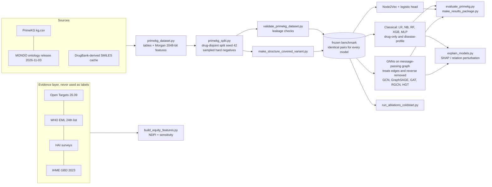
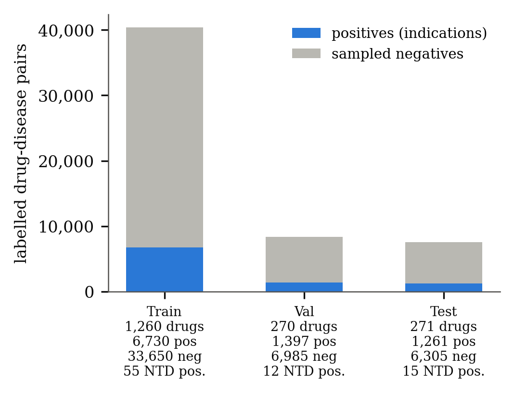
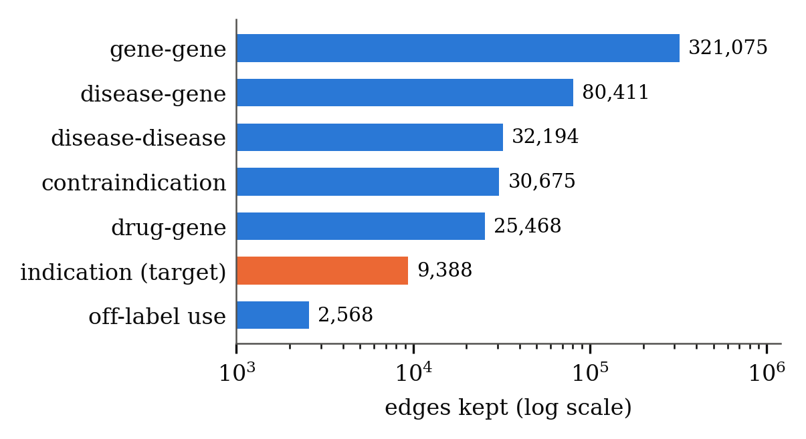
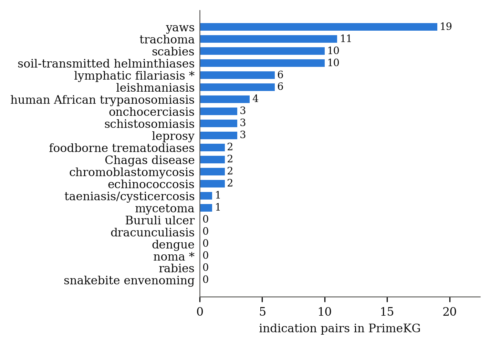

# VectorDrugMatch

**Leakage-controlled drug repurposing on a biomedical knowledge graph, with an equity-aware evidence layer for neglected tropical diseases (NTDs).**

IEEE Computer Society Student Chapter, IAM Pro CS Internship 2026, Ramaiah Institute of Technology, Bangalore.

> **Status (read this first).** The data layer, benchmark, models, evaluation and explanations are implemented and the final Colab run has been completed (2026-11-11). Reported results, the code of record and known caveats are in **`Docs/PROJECT_STATUS.md`** and `reports/research_validation_20261111/`. These are computational benchmark results on sampled negatives and one fixed drug-disjoint split; **no model is claimed to be superior, nothing is clinically validated, and no inference API or web application is deployed.** Predictions are research hypotheses, not treatment advice. The equity score (NDPI) is an exploratory prioritisation aid with documented limits (section 9).

| Variant (selected model) | ROC-AUC / PR-AUC, seed 42 | five seeds, mean ± SD |
|---|---|---|
| PrimeKG (GCN) | 0.7787 / 0.4919 | 0.7880 ± 0.0118 / 0.5285 ± 0.0334 |
| PrimeKG + disease profile (Random Forest) | 0.8043 / 0.6041 | 0.8049 ± 0.0020 / 0.6113 ± 0.0078 |
| Structure-covered (GCN) | 0.7838 / 0.5183 | 0.7847 ± 0.0089 / 0.5390 ± 0.0182 |
| Structure-covered + disease profile (XGBoost) | 0.8433 / 0.6979 | 0.8433 ± 0.0000 / 0.6979 ± 0.0000 |

The disease-profile variants add a training-side feature that can act as a popularity signal; the structure-covered set is a test subset; the five seeds share one split; the basis for choosing the "selected model" is not documented here. Compare rows with care.

## 1. Research problem and motivation
Drug repurposing proposes new indications for existing drugs. Published link-prediction results on knowledge graphs are often optimistic because the same drugs (and their known indications) appear in training and test data. The realistic question is the **cold-start** one: *for a drug the model has never seen with any indication, can it rank its true indications?* VectorDrugMatch builds and audits a benchmark that asks exactly that, and compares classical fingerprint models, a random-walk embedding and five graph neural networks under identical conditions.

## 2. Neglected tropical disease focus
NTDs receive little commercial research interest, so repurposing is attractive, but their labelled indications are few. The project therefore (a) maps the 21 official WHO NTD groupings onto PrimeKG disease nodes with an explicit, audited mapping (22 frozen project groups, 68 benchmark flag nodes, candidate extensions kept separate), (b) reports NTD results as a separate, clearly exploratory subset (82 NTD indication pairs in the benchmark; about 15 positives in the test split), and (c) adds an evidence layer (essential-medicine status, regional medicine availability, disease burden) for prioritisation.

## 3. Contributions (what is in this repository)
1. **A drug-disjoint, leakage-audited indication benchmark on PrimeKG**: 7,957 drugs, 17,080 diseases, 9,388 indications. Contraindications and off-label uses are separate relations and are never labels. Negatives are sampled (hard negatives, 5:1) and never include any known drug-disease pair of any relation.
2. **A structure-covered variant** (pairs whose drug has no usable fingerprint are removed; the held-out positives are unchanged) to measure how much of a result depends on having a chemical structure.
3. **One frozen split for every model**: Logistic Regression, Naive Bayes, Random Forest, XGBoost, MLP, Node2Vec, GCN, GraphSAGE, GAT, RGCN and HGT read the same saved split and negatives.
4. **Two classical-baseline variants**: drug-only, and drug plus a leak-free *disease-profile* block built from training indications only.
5. **Cold-start ablations** including a shuffled-label control that must give ROC-AUC near 0.5, and **explanations** (SHAP for tree models, GNNExplainer for graph models).
6. **Evidence integration kept separate from the benchmark labels**: Open Targets (with per-provider attribution), WHO Essential Medicines List, HAI price/availability surveys, IHME GBD burden, combined into the transparent NDPI with explicit missing-data handling.
7. **Provenance and reproducibility**: SHA-256 release manifest, licence audit, pinned code commit, frozen-data hash checks in the Colab notebook, and tests.

## 4. Architecture



Existing figures from the paper draft (`Docs/paper/figures/`, generated from real data by `scripts/make_paper_assets.py`):

| Split composition | Graph relations | NTD coverage |
|---|---|---|
|  |  |  |

## 5. Data sources and provenance
Raw and derived data are **not** in this repository (git-ignored). `Docs/DATA_PROVENANCE.md` lists, for every dataset, the version, SHA-256 and how it was verified; `Docs/LICENCE_AUDIT.md` records the licence evidence found (no legal conclusions are drawn).

| Source | Used for | Version / note |
|---|---|---|
| PrimeKG (Harvard Dataverse) | graph, indications, contraindications, off-label | dataset marked CC0; constituent licences apply separately |
| MONDO | disease identifier mapping and NTD grouping | release 2026-11-03 (frozen; the pipeline refuses a different one) |
| DrugBank-derived SMILES (cache) | Morgan fingerprints | restricted; never redistributed |
| Open Targets | external evidence, kept separate from labels | release 26.09, identified by byte identity; per-provider attribution |
| WHO EML | essential-medicine component | 24th list (2025), extracted from the official PDF; CC BY-NC-SA 3.0 IGO |
| HAI price/availability | access component (regional pilot) | three Indian surveys 2004-2011, not global access |
| IHME GBD 2023 | burden component | 15 of 22 NTD groups; usage terms forbid third-party hosting |

## 6. Feature engineering
* **Drug**: 2,048-bit Morgan fingerprint from SMILES (996 drugs have no SMILES and 997 have an all-zero fingerprint; they are handled and reported separately, see the `with_structure` / `no_structure` subsets).
* **Disease (original)**: the NTD flag; the burden columns are constant in the frozen benchmark, so the classical baselines see **one** informative disease feature. They are effectively drug-only.
* **Disease-profile block (variant)**: four features per pair computed from training indications only (log count of other training drugs treating the disease; maximum and mean Tanimoto similarity of the candidate drug to those drugs; a has-profile flag), leave-one-out for training positives. Details: `src/features/disease_profile.py`, `tests/test_disease_profile.py`.

## 7. Models
Classical (`src/models/baseline/`): Logistic Regression, Gaussian Naive Bayes, Random Forest, XGBoost, MLP, each with sigmoid calibration where applicable. Graph (`src/models/gnn/`, `scripts/train_node2vec.py`): Node2Vec with a logistic head trained on a leakage-safe walk graph, and GCN, GraphSAGE, GAT, RGCN, HGT with a shared link-prediction head on a message-passing graph from which every `treats` edge, its reverse and any other drug-disease edge on a held-out pair has been removed.

## 8. Cold-start evaluation, leakage prevention and metrics
* **Split**: drugs with at least one indication are partitioned 70/15/15 (seed 42, stratified on having an NTD indication) so no drug appears in more than one split; negatives are drawn per split from that split's drugs and never from any known pair of any relation. 40,380 / 8,382 / 7,566 pairs.
* **Checks** (`scripts/validate_primekg_dataset.py` and the structure-variant validator; 37 checks passed on a regenerated copy of the benchmark): drug sets disjoint; no negative is a known indication, contraindication or off-label pair; no held-out pair reachable through `treats`, `contraindicated_for`, `offlabel_for` or their reverse relations; all `treats` and `rev_treats` edges absent from the message-passing graph; every model gets identical pairs, labels, negatives and features.
* **Reporting rules**: only held-out cold-start predictions are reported; the pooled 5-fold CV that the baseline script also prints is not a cold-start result and is not reported; the thresholds come from the validation split.
* **Metrics**: ROC-AUC, PR-AUC, Brier, MCC, F1, Precision@K, Recall@K, MRR and NDCG@K per disease, each also on `ntd_only`, `mapped_only`, `with_structure` and `no_structure` subsets.

## 9. Explainability, equity evidence and NDPI limitations
* **Explanations**: SHAP for Random Forest/XGBoost on test pairs (cold-start models), a **local relation-family perturbation** for the GNNs (each relation family and its reverse edges are removed from the k-hop neighbourhood and the change in predicted probability is recorded; relation-level, not edge-level; it replaced PyG GNNExplainer during the Colab run). They describe a model, not causal biology.
* **NDPI** = weighted mean of the available components (EML 0.45, burden 0.45, access 0.10), renormalised over what is present; a missing component is never treated as 0. **Limitations**: the weights are an unvalidated proposal; burden (IHME) exists for 50 of 82 NTD pairs and for no non-NTD pair, so NDPI is burden-aware only there; access is a regional historical pilot; EML status 0 means "no candidate entry found", not a verified absence; on the burden-aware pairs the ranking changes materially with the weights (Spearman against the default from -0.42 to a median of 0.87 over a 66-point grid). It has no external validation.

## 10. Installation and reproduction
```bash
git clone https://github.com/MUKUL-PRASAD-SIGH/VectorDrugMatch && cd VectorDrugMatch
python -m venv venv && source venv/bin/activate        # Windows: venv\Scripts\activate
pip install -r requirements.txt                         # validated local versions: requirements-validated-local.txt
python -m pytest -q tests                               # tests that need local data are skipped on a fresh clone
```
Data layer on your machine (needs the private inputs listed in `Docs/COLAB_TRAINING_HANDOFF.md`): `python scripts/run_full_pipeline.py --stage prepare` then `--stage external`. `--dry-run` prints every command without running it.

**Final experiment (Google Colab, GPU)** - completed 2026-11-11; to re-run, pin `1c85d98` and follow `Docs/COLAB_BEGINNER_HANDBOOK.md` (step by step) or `Docs/COLAB_TRAINING_HANDOFF.md` (reference). Training is resumable (`--resume`) and writes everything to Google Drive.

## 11. Project structure
```
configs/        experiment configs (full, structure-covered, and *_dp disease-profile variants)
scripts/        data build, split, validation, training, evaluation, ablations, explanations, equity/NDPI, release freezing
src/data/       dataset, graph builder, MONDO mapping       src/features/   drug, disease, disease-profile, pair features
src/models/     baseline/ (5 classical) and gnn/ (GCN, GraphSAGE, GAT, RGCN, HGT)
src/explainability/  SHAP and relation-perturbation helpers          src/scoring/    NDPI, EML status, similarity, literature
src/utils/      metrics, ranking, results I/O
tests/          unit and static tests (leakage, features, EML extraction, resume, explainability)
notebooks/      colab_final_run.ipynb (the final run, pinned to a commit)
Docs/           paper draft, provenance, licence audit, data dictionary, handoff documents, release manifest (index: Docs/README.md)
legacy/         earlier-phase scripts, notebooks and planning documents, kept for history and NOT used by the final pipeline (legacy/README.md)
data/ outputs/  git-ignored; produced locally or in Colab
```
Earlier-phase scripts (`main_pipeline.py`, `train_benchmark.py`, `run_ablations.py`, `optuna_gnn.py`, `validate_pipeline.py`, `evaluate.py`, `export_codebase.py`, `validate_negatives.py`), the three root helper scripts, two old notebooks and the early planning documents were moved with `git mv` into `legacy/` (history preserved, nothing deleted). Their results must not be reported as cold-start results. `scripts/preprocess.py` and `config.yaml` remain because other scripts reference them.

## 12. Limitations and future work
* Results exist for four selected variants only in this repository; a single fixed split (five training seeds); NTD evaluation rests on 15 test positives; the disease-profile features may encode popularity; the GCN was stabilised during the run (`Docs/PROJECT_STATUS.md` section 3); two report figures need regeneration (section 6 there).
* Sampled negatives are unlabelled pairs, not proven non-treatments; 996 drugs lack a structure; 9,089 disease nodes lack a DOID.
* Open Targets overlap with PrimeKG is **not** independent validation (shared upstream sources); the `UNVALIDATED_INDICATION` flag semantics are undocumented upstream.
* Equity layer limits as in section 9; seven NTD groups have no burden value.
* Future work (not started): split-level resampling, a model-score by NDPI candidate ranking over unseen drug-disease pairs, further external validation. A GCN inference package exists in private Drive but there is no deployed API or web application and no inference code path published here (`legacy/docs/API.md` is an early design note only).

## 13. Licence and data
No code licence file is included yet; choose one before release. Third-party data carry their own terms (`Docs/LICENCE_AUDIT.md`); DrugBank-derived, IHME, WHO EML and Open Targets-derived files must not be redistributed through this repository. Three small DrugBank-derived files exist in the **history** of the `mukul` branch (not in the current tree); see `Docs/RELEASE_AUDIT.md`.

## 14. Documentation index
`Docs/PROJECT_STATUS.md` (**current status and caveats**) · `reports/research_validation_20261111/` · `Docs/COLAB_RESEARCH_VALIDATION_LOG.md` · `Docs/COLAB_BEGINNER_HANDBOOK.md` (how to re-run) · `Docs/COLAB_TRAINING_HANDOFF.md` · `Docs/FINAL_PROJECT_HANDOFF.md` · `Docs/RELEASE_AUDIT.md` · `Docs/paper/PAPER_DRAFT_IEEE.md` · `Docs/DATA_PROVENANCE.md` · `Docs/LICENCE_AUDIT.md` · `Docs/DATA_DICTIONARY.md` · `Docs/EQUITY_DATA_SPECS.md` · `Docs/NTD_MAPPING.md` · `Docs/FINAL_RELEASE_READINESS.md`.
